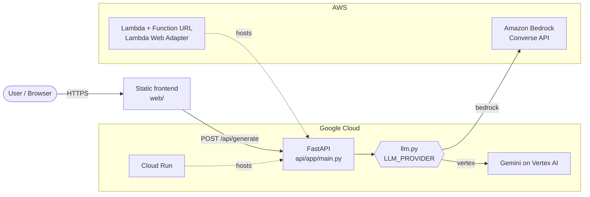

# Architecture

> Keep this diagram matching what's actually deployed. `/demo-check` flags drift. GitHub renders Mermaid natively, and for slides you can paste it into https://mermaid.live and export a PNG.

Delete the cloud you're not using, and add the project's own pieces (data stores, agents, tools) as you build them.
